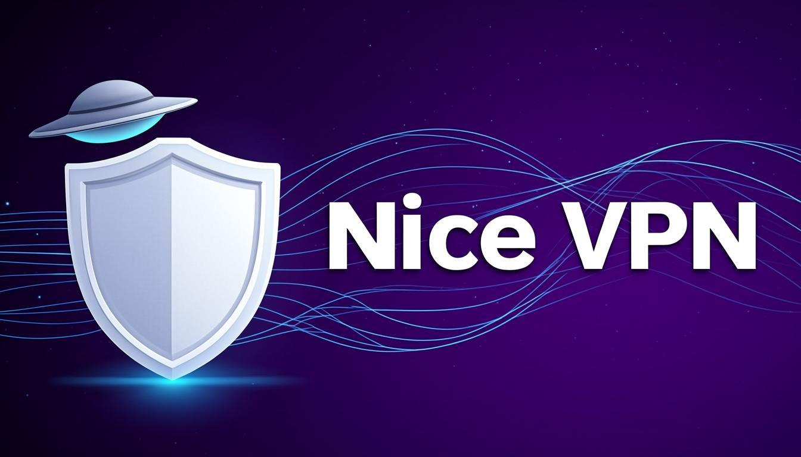
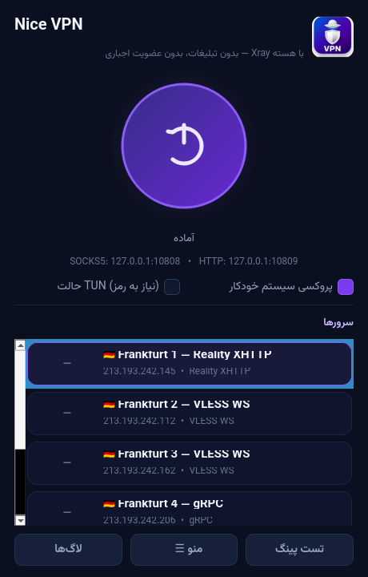
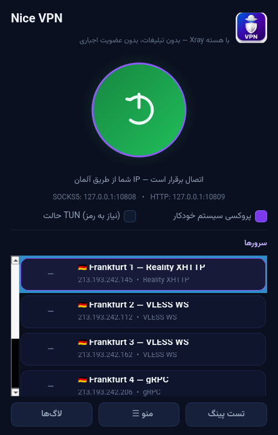

# Nice VPN

<p align="center">
  
</p>

<p align="center">
  <b>کلاینت تمیز و سبک Xray/VLESS برای فدورا KDE و ویندوز</b><br>
  بدون تبلیغات • بدون عضویت اجباری • بدون ریموت‌کانفیگ
</p>

---

## چرا Nice VPN؟

Nice VPN بازنویسی تمیز کلاینتی است که کانفیگ‌هایش از اپ اندرویدی «UFO VPN Mod» استخراج شده.
برخلاف اپ اصلی، این نسخه:

| ویژگی | UFO VPN Mod (اندروید) | Nice VPN |
|---|---|---|
| تبلیغات (AdMob/AppLovin و…) | ✔ دارد | ✖ حذف شده |
| عضویت اجباری کانال تلگرام (@VPNbaz / @anty_filter) | ✔ دارد | ✖ حذف شده |
| کانال ریموت‌کانفیگ (GitHub) | ✔ دارد (دستکاری‌پذیر) | ✖ لیست آفلاین داخل خود برنامه |
| DexClassLoader / کد داینامیک | ✔ دارد | ✖ ندارد |
| پلتفرم | اندروید | فدورا KDE (RPM) + ویندوز x64 (پرتابل) |

امکانات:
- هسته **Xray-core** با ۵ سرور آماده (آلمان/فرانکفورت): Reality XHTTP، VLESS WS، gRPC
- پروکسی سیستم خودکار — **KDE Plasma** (kioslaverc) و **GNOME** (gsettings) و **ویندوز** (WinINET)
- آیکون در system tray، تست پینگ رنگی، لاگ زنده
- افزودن کانفیگ دلخواه: `vless://` / `vmess://` از کلیپ‌بورد، فایل یا سابسکریپشن
- بلاک تبلیغات (`geosite:category-ads-all`) و روتینگ مستقیم سایت‌های ایرانی (`category-ir` + `geoip:ir`)
- حالت CLI برای اسکریپت‌نویسی

## اسکرین‌شات

<p align="center">
  
  &nbsp;
  
</p>

## نصب — فدورا (KDE Plasma)

**روش ۱ — بسته RPM (پیشنهادی):**

```bash
# دانلود آخرین نسخه از Releases و نصب:
sudo dnf install ./nicevpn-1.0.0-1.x86_64.rpm
# اجرا از منوی برنامه‌ها یا:
nicevpn
```

**روش ۲ — اسکریپت آماده:**

```bash
curl -fsSL https://raw.githubusercontent.com/melimcrr-crypto/nice-vpn/main/install-fedora.sh | bash
```

وابستگی‌ها (RPM خودش هندل می‌کند): `python3` و `python3-pyside6`

## نصب — ویندوز (10/11، x64)

1. از [Releases](https://github.com/melimcrr-crypto/nice-vpn/releases) فایل `NiceVPN-1.0.0-Windows-x64.zip` را بگیرید
2. Extract کنید و روی **`NiceVPN.bat`** دوبار کلیک کنید — نیاز به نصب ندارد (پرتابل)
3. اگر باز نشد: `NiceVPN-debug.bat` را اجرا کنید؛ در اکثر موارد نصب
   [VC++ Redistributable](https://aka.ms/vs/17/release/vc_redist.x64.exe) حلش می‌کند
4. برای شورتکات دسکتاپ با آیکون: `MakeShortcut.bat`

> نسخه ویندوز شامل Python 3.11 embeddable + PySide6 + xray.exe است؛ چیزی روی سیستم‌تان نصب نمی‌شود.

## استفاده از CLI

```bash
nicevpn --cli list              # لیست سرورها
nicevpn --cli list --ping       # با تست پینگ
nicevpn --cli connect 1 --proxy # اتصال به سرور ۱ + پروکسی سیستم
nicevpn --cli disconnect        # قطع
```

## پورت‌ها

| سرویس | آدرس |
|---|---|
| SOCKS5 (با UDP) | `127.0.0.1:10808` |
| HTTP | `127.0.0.1:10809` |

برنامه‌هایی که پروکسی سیستم را رعایت نمی‌کنند را با این متغیرها هدایت کنید:

```bash
export http_proxy=http://127.0.0.1:10809
export https_proxy=http://127.0.0.1:10809
export all_proxy=socks5://127.0.0.1:10808
```

## ساخت از سورس

```bash
git clone https://github.com/melimcrr-crypto/nice-vpn.git
cd nice-vpn
bash tools/fetch-binaries.sh          # دانلود xray + geo
python3 -m pip install PySide6        # یا: sudo dnf install python3-pyside6
python3 -m nicevpn                    # اجرای مستقیم
# ساخت بسته‌ها:
bash tools/build-rpm.sh               # → dist/nicevpn-1.0.0-1.x86_64.rpm
bash tools/build-windows.sh           # → dist/NiceVPN-1.0.0-Windows-x64.zip
```

(در CI فقط کافی است تگ `v*` بزنید؛ گردش‌کار `.github/workflows/release.yml` خودش RPM و زیپ ویندوز را ساخته و به Release اضافه می‌کند و تست اتصال واقعی هم می‌گیرد.)

## نکات امنیتی و سلب مسئولیت

- کانفیگ‌های داخلی از بسته اندرویدی UFO VPN استخراج شده‌اند و **UUID اشتراکی** دارند؛ برای استفاده شخصی و عبور از فیلترینگ است، نه حفظ حریم خصوصی کامل.
- ترافیک شما از سرورهای ناشناس (فرانکفورت) عبور می‌کند — برای کارهای حساس از سرور شخصی خودتان استفاده کنید (از منو کانفیگ `vless://` خودتان را اضافه کنید).
- این پروژه فقط **کلاینت** است؛ مسئولیت استفاده بر عهده کاربر است.

## ساختار پروژه

```
nice-vpn/
├── nicevpn/               # پکیج اصلی (PySide6 + هسته xray)
│   ├── gui.py             # رابط گرافیکی (RTL فارسی، تم تیره)
│   ├── core.py            # مدیریت پروسه xray
│   ├── xrayconf.py        # تولید کانفیگ JSON (routing ایران/تبلیغات)
│   ├── sysproxy.py        # پروکسی سیستم: KDE/GNOME/WinINET
│   ├── nodes.py           # لیست سرورهای داخلی + پارس vless/vmess
│   └── assets/            # لوگو، آیکون‌ها، فونت وزیرمتن
├── configs/               # نسخه خام base64 نودها (استخراج از APK)
├── tools/                 # اسکریپت‌های build و تست
├── packaging/rpm/         # Spec فایل RPM
├── packaging/windows/     # لانچرها و راهنمای ویندوز
└── .github/workflows/     # build + release + تست اتصال
```

## اعتبارها

- [Xray-core](https://github.com/XTLS/Xray-core) — هسته پروکسی (MPL 2.0)
- [PySide6 / Qt](https://www.qt.io/) — رابط کاربری (LGPL v3)
- [Vazirmatn](https://github.com/rastikerdar/vazirmatn) — فونت فارسی (OFL 1.1)
- لوگو: UFO + Shield — طراحی‌شده برای این پروژه

## لایسنس

MIT — متن کامل در [LICENSE](LICENSE)
